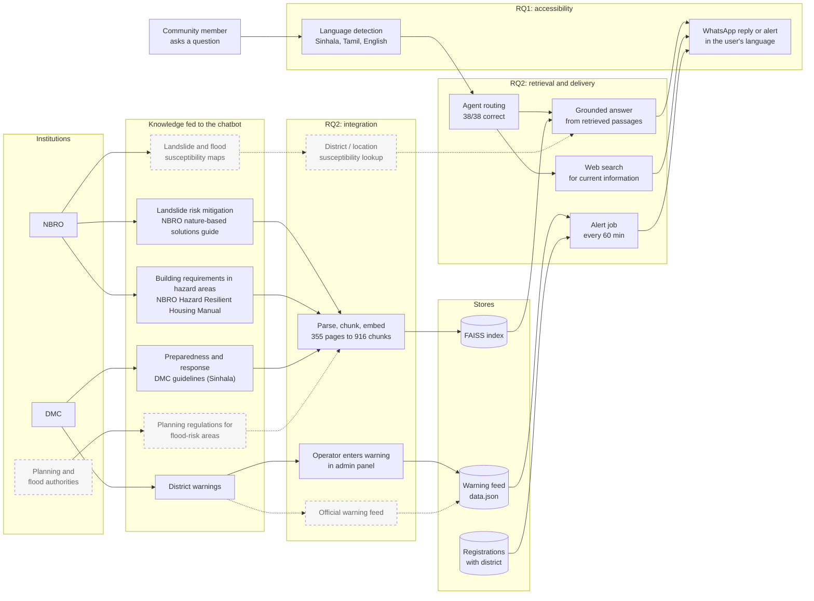
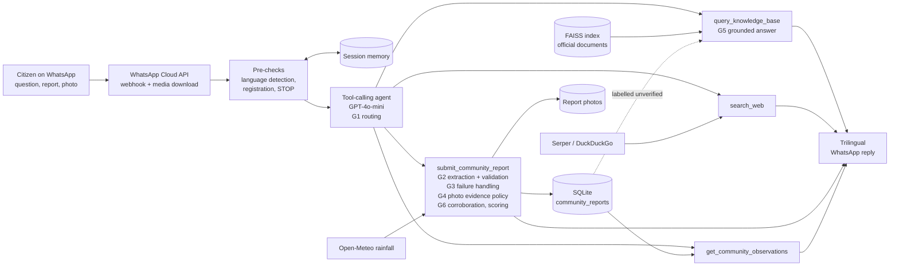
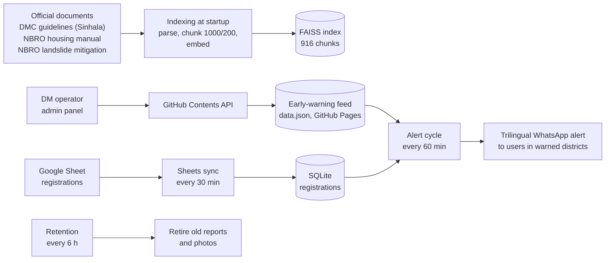

# Research Contribution Mapping: Objectives, Research Questions and Evidence

This document maps the system and its evaluation results to the project's objectives and research questions. It sets out the framework used to show improvement (each function compared with a baseline on the same items), states the contribution for each research question, and lists what is still needed before each question can be fully answered.

All numbers come from files in this repository. Section 9 lists the source of each one.

---

## 1. Objectives and research questions

**Objective 1.** Feed information on landslide and flood susceptibility mapping, and on regulations for landslide-prone and flood-risk areas, to the chatbot.

- **RQ1.** What are the key considerations for designing a chatbot that incorporates susceptibility mapping and planning/regulatory requirements while staying relevant and accessible for diverse Sri Lankan user groups?
- **RQ2.** What methods can integrate, retrieve and deliver this institutional knowledge and current official warning information through the chatbot?

**Objective 2.** Test and evaluate the disaster management chatbot with DM experts and communities to identify gaps, challenges and potentials for landslide and flood risk management.

- **RQ3.** How accurately and reliably does the chatbot perform its core functions?
- **RQ4.** What gaps, challenges and potentials are identified through community and expert evaluation?

---

## 2. Central contribution

> A trilingual (Sinhala, Tamil, English) WhatsApp chatbot that delivers official landslide and flood guidance and district warnings to Sri Lankan communities, and lets citizens report hazards back. Each core function was evaluated against a simpler baseline on the same test items. Against rule-based baselines, report detection rose from 9% to 100% and complete report extraction from 3% to 48% (both p ≤ 0.002). The evidence policy halved the share of non-supporting photographs accepted as evidence (50% to 25%, p = 1.2×10⁻⁷) without rejecting any supporting photograph.

The study's position: an LLM alone is not reliable enough to handle disaster information. What makes the system usable is the combination of LLM components with controls (grounding in official documents, output validation, evidence rules, and keeping citizen reports apart from official advice), and each control has a measured effect.

### 2.1 System data flow

Data enters the system through five routes: official documents indexed for retrieval, citizen messages and reports over WhatsApp, live web search, district warnings published by an operator, and user registrations from a Google Sheet. Scheduled jobs crawl the warnings, sync registrations and retire old reports.

Diagram (0) shows Objective 1 end to end: which institutional knowledge is fed to the chatbot, how it is integrated (RQ2), how it is retrieved and delivered (RQ2), and how delivery is made accessible to different user groups (RQ1). Solid boxes are implemented; dashed boxes are not yet integrated (see Section 4.3). Diagrams (a) and (b) show the full system.

**(0) Objective 1: how institutional knowledge reaches users**



**(a) Live flow: a citizen message to a reply**



**(b) Background flow: knowledge ingestion, warnings and scheduled jobs**



| Route | How data arrives | Where it goes | Gate or objective |
|---|---|---|---|
| Official documents | PDFs placed in `training-files/`, indexed at startup | FAISS index | RQ2 integration; G5 |
| Citizen questions | WhatsApp webhook, pre-checks, agent routing | Grounded answer from the index, or web search | RQ1, RQ2; G1, G5 |
| Citizen reports and photos | WhatsApp webhook and media download, report tool | SQLite and photo storage, after extraction, validation, evidence policy, rainfall check and scoring | G1 to G4, G6 |
| Live web information | `search_web` tool (Serper, DuckDuckGo fallback) | Reply only, not stored | RQ2 |
| District warnings | Operator edits warnings in the admin panel, written to `data.json` through the GitHub API; the alert job reads it every 60 minutes | Trilingual alerts to registered users in warned districts | RQ2 delivery |
| Registrations | Google Sheet synced every 30 minutes (also on startup and on demand from the admin panel) | SQLite `registrations` | RQ1 location relevance |
| Retention | Job every 6 hours | Retires old reports and photos | Data minimisation |

Citizen reports never enter the FAISS index. They reach other users only as labelled, unverified context or through `get_community_observations`.

---

## 3. Evaluation framework: gate-wise paired evaluation

The system is treated as a chain of **gates**. Each gate is one function that controls one specific risk to the user. Every gate is evaluated the same way:

1. **Risk.** What goes wrong if the gate is missing or weak.
2. **Baseline (before).** The simpler alternative: keyword rules, the earlier policy, or answering without retrieval.
3. **System (after).** The production component.
4. **Same items.** Both are scored on the same test items with the same scoring code (a paired design).
5. **Test.** Exact McNemar test on the discordant pairs for yes/no outcomes; Wilson or bootstrap intervals for single rates.
6. **Evidence strength.** Significant, deterministic (proven by regression test), directional (better but not significant), or open (not yet measured).

The paired design matters because it removes item difficulty from the comparison. Any difference comes from the component, not from a different test set.

```
Citizen message
   │
   ├─ G1 Report detection ──── is this a hazard report or a question?
   │      ├─ question ── G5 Grounded advice (official documents, web search)
   │      └─ report ──── G2 Structured extraction ── what, where, ongoing, people at risk
   │                        ├─ G3 Failure handling ── a broken model reply adds nothing
   │                        ├─ G4 Photo evidence ──── only supporting photos add confidence
   │                        └─ G6 Corroboration ───── weight by agreement and reporter history
   │
   └─ Outbound: district warning feed ── trilingual WhatsApp alerts to registered users
```

### 3.1 Results by gate

| Gate | Risk controlled | Before (baseline) | After (system) | Test | Strength |
|---|---|---|---|---|---|
| **G1 Report detection** | A citizen's report is missed | Keyword rules: 1/11 reports (9%) | LLM agent: 11/11 (100%); no false alarms on 27 non-reports for either | McNemar p = 0.002 | Significant |
| **G2 Structured extraction** | A report is misunderstood | Keyword extractor: all 5 fields correct on 1/29 (3%) | LLM: 14/29 (48%) | McNemar p = 0.001 | Significant |
| **G3 Failure handling** | A failed model reply is counted as evidence | A failed vision call added +0.05 confidence | Adds 0 | Regression tests | Deterministic |
| **G4 Photo evidence policy** | An irrelevant photo boosts a false report | Earlier policy: 48/96 non-supporting photos counted as support (50%) | 24/96 (25%); supporting photos kept 37/37 | McNemar p = 1.2×10⁻⁷; replicated 49% to 24% | Significant |
| **G5 Grounded advice** | The bot invents safety advice | Same model without documents: hallucination 20.0%, faithfulness 4.40/5 | With retrieval: 13.3%, 4.67/5 | p ≥ 0.30, n = 30 | Directional |
| **G6 Corroboration** | One unreliable reporter is believed | Not measured | Formula matches its reference exactly; under 10 ms at 50 reporters | None | Open |

### 3.2 G2 by field (same 29 labelled reports)

| Field | Keyword extractor | LLM extraction | McNemar p |
|---|---|---|---|
| Hazard type | 0.48 | **0.79** | 0.02 |
| Report domain | 0.48 | **0.79** | 0.01 |
| Location present | 0.14 | **1.00** | < 0.001 |
| Ongoing | 0.38 | **0.93** | < 0.001 |
| People at risk | 0.69 | 0.69 | 1.0 |
| **All 5 fields** | **0.03** | **0.48** | **0.001** |
| All fields except location | 0.14 | 0.48 | 0.02 |

The keyword extractor cannot return a location by design, so the last row removes that field. The improvement remains significant without it. People-at-risk detection did not improve; it is the clearest target for the next iteration.

### 3.3 G4 by type of non-supporting photo (AI reference labels)

| Subset | Earlier policy | Evidence policy v2 | McNemar p |
|---|---|---|---|
| All non-supporting photos | 48/96 (50%) | 24/96 (25%) | 1.2×10⁻⁷ |
| Photo contradicts the caption | 34/53 (64%) | 12/53 (23%) | 4.8×10⁻⁷ |
| No hazard visible | 26/69 (38%) | 8/69 (12%) | 7.6×10⁻⁶ |
| Supporting photos wrongly rejected | 0/37 | 0/37 | – |

The improvement was better in 9 of 11 event groups and worse in none (event-cluster bootstrap: 25.0 points, 95% CI 16.1 to 32.8). A second run with the same frozen code gave 47/96 to 23/96.

---

## 4. Objective 1

### 4.1 RQ1: Design considerations for relevance and accessibility

| Consideration | How the system addresses it | Evidence |
|---|---|---|
| Reach people on a channel they already use | WhatsApp; no app to install | Live deployment: 0 failures in 60 probes |
| Language diversity | Script-based detection of Sinhala, Tamil and English; replies and alerts in all three | Detection 30/30 (100%, Wilson CI 88.7 to 100%); answer time similar across languages (en 3.25 s, si 3.60 s, ta 3.38 s) |
| Location relevance | Users register a district; alerts go only to warned districts | `agent/registration.py`, `agent/alert_sender.py` |
| Official advice kept apart from rumour | Citizen reports are stored separately from the official knowledge base and shown only as labelled, unverified context | Architecture, `agent/reporter.py` |
| Low cost and low connectivity | Rule-based pre-checks (STOP, greeting, registration) run before any LLM call | Pre-checks take microseconds; about $0.005 per photo report |
| Participation, not only broadcast | Citizens can report hazards with photos | Gates G1 to G4 |

**Contribution to RQ1.** A set of design considerations for a disaster chatbot in a multilingual, low-resource setting, each supported by a system measurement.

### 4.2 RQ2: Methods to integrate, retrieve and deliver institutional knowledge and warnings

| Method | What it does | Evidence |
|---|---|---|
| Integration | Official documents parsed, chunked and embedded: DMC disaster guidelines (Sinhala), NBRO Hazard Resilient Housing Manual, NBRO nature-based solutions for site-specific landslide risk mitigation. 355 pages, 916 chunks | `bench_00` |
| Retrieval | Vector search over the indexed documents | Recall@k 0.65 to 0.67 (keyword proxy, n = 60) |
| Grounded delivery | Answers are generated from retrieved passages | G5: hallucination 20.0% to 13.3% against the same model without documents |
| Choosing the source | A tool-calling agent decides between official documents, live web search, report submission and community observations | 38/38 correct (100%, Wilson CI 90.8 to 100%) |
| Warning delivery | An hourly job reads the district warning feed and sends trilingual WhatsApp alerts to registered users in warned districts | `agent/alert_crawler.py`, `agent/alert_sender.py`, `agent/scheduler.py` |

**Contribution to RQ2.** An agentic retrieval method that brings institutional guidance, live information and district warning delivery into one conversational channel, with measured routing accuracy and grounding.

### 4.3 Limits of Objective 1 as implemented

- The knowledge base contains guidance and building documents. It does **not yet contain susceptibility maps** (spatial data) or **flood-zone and planning regulations**. Either these are added (for example NBRO landslide hazard zonation guidance and UDA flood-zone regulations) or the result is reported as "guidance and building regulations, with susceptibility maps as future work".
- The warning feed (`early-warning-site/data.json`) is **updated by an operator**, not pulled from an official DMC or NBRO source. The delivery mechanism is demonstrated; integration with an official feed is pending.

---

## 5. Objective 2

### 5.1 RQ3: Accuracy and reliability of core functions

RQ3 is answered by the gate framework in Section 3, together with these system-level results:

| Function | Result | Source |
|---|---|---|
| Report detection (G1) | 9% to 100% against keyword rules, p = 0.002 | `results/11_rule_baselines.json` |
| Report extraction (G2) | 3% to 48% complete extraction, p = 0.001 | `results/11_rule_baselines.json` |
| Photo evidence (G4) | 50% to 25% false support, p = 1.2×10⁻⁷, replicated | ICITR live runs |
| Grounded answers (G5) | Hallucination 20.0% to 13.3%, not significant | `results/09_rag_vs_closedbook_baseline.json` |
| Tool routing | 38/38 | `results/03_agent_routing.json` |
| Language detection | 30/30 | `results/07_language_detection.json` |
| Live reliability | 0/60 failures; about 755 ms network floor | `results/10_live_deployment_probe.json` |
| Response time | RAG answer 3.33 s mean; agent turn 6.21 s mean | `results/02`, `results/03` |

**Contribution to RQ3.** A paired before/after evaluation of each chatbot function against simpler baselines, showing where LLM components clearly outperform rules (detection, extraction, evidence handling), where the gain is not yet significant (grounded answers) and where it is absent (people-at-risk detection).

### 5.2 RQ4: Gaps, challenges and potentials from community and expert evaluation

| Source | Status | What it contributes |
|---|---|---|
| Technical evaluation | Complete | Gaps and challenges listed below |
| Community evaluation | **3 real responses**; the other 47 rows in the current workbook are synthetic demo data and must not be reported | Usability, clarity, usefulness, trust, participation |
| Expert evaluation (DMC, NBRO) | **Not yet done** | Correctness of advice, regulatory accuracy, operational fit |

Gaps and challenges already identified by the technical evaluation:

| Type | Finding |
|---|---|
| Gap | Retrieval recall is 0.65 to 0.67; about one question in three does not retrieve a passage with the expected content |
| Gap | People-at-risk detection is 0.69 and no better than keyword rules |
| Gap | The vision model never labelled a photo as contradicting its caption (0/51); the gain in G4 comes from discounting photos the model judged to show no hazard |
| Gap | 13 of 15 blurred, darkened or downscaled photos still added support |
| Challenge | Production runs a single replica with process-local session state (no working Redis); SQLite allows one writer at a time |
| Challenge | Confidence and corroboration scores are heuristic, not calibrated probabilities |
| Potential | Citizen reports give authorities a new, structured data source from the field |
| Potential | Photo evidence can confirm reports when the text alone is too short to classify |
| Potential | One channel serves Sinhala, Tamil and English speakers without separate systems |

**RQ4 cannot be answered until the community and expert studies are complete.** The minimum needed:

1. 15 to 20 real community participants on the existing questionnaire (14 items, 5 dimensions). Replace the synthetic rows; do not mix them.
2. 3 to 5 DM experts rating about 20 chatbot answers for correctness and regulatory accuracy, followed by a short interview on gaps.
3. Report the findings in three groups: gaps, challenges, potentials.

If the community study rates trust and timeliness lowest, report it as appropriate caution rather than failure: the extraction results (Section 3.2) show the system is not always right, so users being careful with unverified reports is the intended outcome. The design response is to show verification status and source in each reply ("unverified, 1 report" against "confirmed by 3 reporters and rainfall data").

---

## 6. Contributions

1. **Design (RQ1).** Design considerations for a trilingual WhatsApp disaster chatbot in Sri Lanka, each backed by a system measurement.
2. **Method (RQ2).** Agentic integration of institutional guidance, live web information and district warning delivery in one channel, with 100% routing accuracy on 38 labelled messages.
3. **Evaluation framework and results (RQ3).** A gate-wise paired evaluation against rule-based baselines: report detection 9% to 100%, complete report understanding 3% to 48%, non-supporting photo evidence 50% to 25%, all significant on the same items.
4. **Extension beyond the stated objectives.** A governed two-way community reporting pipeline that validates model output, discounts unsupported photo evidence and keeps unverified citizen reports separate from official advice.
5. **Gaps, challenges and potentials (RQ4).** Technical gaps identified now; community and expert findings to follow the studies in Section 5.2.

---

## 7. Status

| Research question | Status |
|---|---|
| RQ1 | Answered with system evidence; community confirmation pending |
| RQ2 | Answered for guidance documents and warning delivery; susceptibility maps and an official warning feed not yet integrated |
| RQ3 | Answered, with significant paired results for three gates |
| RQ4 | Partly answered (technical gaps); community and expert evaluation outstanding |

---

## 8. Wording to use and avoid

| Avoid | Use instead | Reason |
|---|---|---|
| "Bayesian truth discovery", "P(true)" | "reputation-weighted corroboration", "corroboration score" | The formula is a product-of-odds combination, not a posterior, and is not calibrated |
| "Extracts information correctly 48% of the time" | "All five fields correct in 48% of reports (3% for keyword rules); individual fields 0.69 to 1.00" | 0.48 is the strictest metric and hides the per-field results |
| "The system detects contradicting photos" | "The system discounts photos the model judges to show no hazard" | Contradiction detection never fired (0/51) |
| "Photo evidence is reliable" | "Non-supporting photo evidence was halved" | 24/96 still added support |
| "RAG reduces hallucination" | "RAG showed a lower hallucination rate, not significant at n = 30" | p ≥ 0.30 |
| Any community-evaluation figure from the current workbook | Figures from real participants only | 47 of 50 current rows are synthetic |

Photo evidence reference labels come from a single AI annotator, not human annotators; state this wherever G4 is reported.

---

## 9. Evidence index and reproduction

| Result | Script | Output |
|---|---|---|
| G1, G2 paired baselines | `evaluation/bench_11_rule_baselines.py` (no API calls) | `evaluation/results/11_rule_baselines.json` |
| Tool routing | `evaluation/bench_03_agent_routing.py` | `evaluation/results/03_agent_routing.json` |
| LLM extraction | `evaluation/bench_04_reporting_pipeline.py` | `evaluation/results/04_reporting_pipeline.json` |
| Corroboration correctness | `evaluation/bench_05_triangulation_bayesian.py` | `evaluation/results/05_triangulation_bayesian.json` |
| Language detection | `evaluation/bench_07_language_detection.py` | `evaluation/results/07_language_detection.json` |
| RAG vs no retrieval | `evaluation/bench_09_rag_vs_closedbook_baseline.py` | `evaluation/results/09_rag_vs_closedbook_baseline.json` |
| Live deployment | `evaluation/bench_10_live_deployment_probe.py` | `evaluation/results/10_live_deployment_probe.json` |
| G3, G4 photo evidence | `evaluation/icitr_reporting/` | `runs/20261005T033433Z_test_live/analysis/`, replicate in `runs/20261005T040118Z_test_live_replicate/analysis/`; claims 3, 39 to 49 in `evidence/CLAIMS_MATRIX.md` |

`bench_11` scores the keyword components on the current code against the LLM outputs stored by the original `bench_03` and `bench_04` runs. The items and scoring code are identical; the runs were not made on the same day. G1 has 11 reports, so report exact counts alongside percentages.
